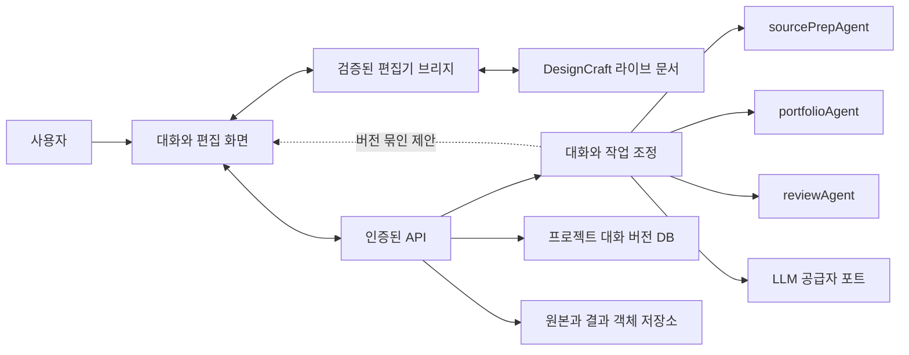

# 에이전트–편집기 아키텍처

## Design Paradigm

계층형 포트와 어댑터. 사용자와 에이전트는 같은 프로젝트를 보며, 실행 중인 DesignCraft 문서는 단일 편집 소유자다. LLM은 제한된 도구와 명시된 자료를 사용해 제안하고, 검증된 편집기 어댑터가 변경을 실행한다. 클라우드 공급자와 모델은 교체 가능한 경계다.

## Inherited Invariants

상위 `_bmad-output/planning-artifacts/architecture/portfolio-agent/ARCHITECTURE-SPINE.md`의 AD-1~AD-6과 ADR-0009를 상속한다. 코어 의존 방향, 편집 판단과 실행 분리, 원본·출처 보존, 다분야 출력 규격, blocking/advisory 및 독립 리뷰, 권리 경계를 유지한다. 상위 spine은 draft이며 새 구현의 검증 결과가 아니다.

## Invariants & Rules

### AE-1 — 역할과 소유권 [ADOPTED]
- **Binds:** 대화 오케스트레이터, 소스 준비·포트폴리오·리뷰 에이전트, 편집기
- **Prevents:** 여러 에이전트의 동시 문서 쓰기와 책임 중복
- **Rule:** sourcePrepAgent는 원본을 보존하며 파생 자료를 제안·생성한다. portfolioAgent는 의도·페이지 계획·편집 제안을 만든다. reviewAgent는 특정 결과를 독립 검토한다. 오케스트레이터는 권한·상태·호출을 조정하며 판단이나 렌더링을 대체하지 않는다. 라이브 문서는 DesignCraft만 변경한다.

### AE-2 — 읽기와 수정 경계 [ASSUMPTION]
- **Binds:** 브라우저 브리지와 백엔드 편집 포트
- **Prevents:** LLM의 임의 파일 접근, 셸 실행 또는 지원하지 않는 조작
- **Rule:** 버전이 지정된 capability, 문서·페이지·선택 요소·출처·미리보기 읽기와 명시적 편집 연산만 허용한다. 요청과 결과는 검증된 스키마·크기·출처·프로젝트 범위를 갖는다. 미지원 기능은 오류로 반환하며 성공으로 꾸미지 않는다. 브라우저 origin 검사는 사용자 인증을 대체하지 않는다.

### AE-3 — 버전·동시성·원자성 [ASSUMPTION]
- **Binds:** 사람 편집, 에이전트 제안, 저장과 재시도
- **Prevents:** 오래된 제안 적용, 중복 실행, 부분 변경의 성공 오인
- **Rule:** 제안은 문서 ID와 live revision, 대상 ID, 입력 출처 및 변경 범위를 가진다. 편집기 단일 쓰기 경계에서 revision 비교와 적용을 원자적으로 수행하고 불일치 시 충돌을 반환한다. 묶음 수정은 원자적 트랜잭션 또는 검증된 복구가 가능할 때만 허용한다. 프로젝트·문서·세션 범위의 request ID와 내용 해시를 사용해 중복 적용을 막고, 재시작 후 성공 여부를 모르면 자동 재실행하지 않는다. 저장된 버전은 불변이며 원본과 다르다.

### AE-4 — 제안·승인·검토 [ASSUMPTION]
- **Binds:** 사용자 경험, 수정 도구, 결과 확정
- **Prevents:** 예기치 않은 변경과 이전 리뷰의 재사용
- **Rule:** 기본은 수정 내용과 영향 범위를 보여 주고 사용자가 적용한다. 자동 적용은 명시적으로 허용된 연산·범위에만 한정한다. 위험한 크롭·재생성은 별도 승인한다. 모든 수정의 전후 이력과 실행 결과를 기록하고 변경된 결과에 연결된 기존 검토를 무효화한다. 편집기 undo는 서버 이력과 동기화가 검증될 때만 복구 수단으로 주장한다.

### AE-5 — 사용자 자료와 권한 [ASSUMPTION]
- **Binds:** 인증, DB, 객체 저장소, API, 백그라운드 작업
- **Prevents:** 다른 사용자의 프로젝트·파일·작업·대화 노출
- **Rule:** 서버는 인증된 주체와 프로젝트 권한을 모든 읽기·쓰기·파일·작업 경로에서 검증한다. 원본·파생·문서 버전과 대화는 프로젝트에 소속되며 교차 참조를 검사한다. 모델에 보낸 자료와 범위를 기록한다. 이 규칙이 구현·검증되기 전 현재 API는 로컬 전용이다.

### AE-6 — 작업·실패·복구 [ASSUMPTION]
- **Binds:** 모델 실행, 생성, 미리보기, 저장 및 내보내기
- **Prevents:** 종료된 작업을 성공으로 표시하거나 결과 없는 완료 알림
- **Rule:** 작업은 입력 버전·요청 ID·상태·오류·산출물·실제 모델 식별자를 기록한다. 중단·실패와 재시도 가능성을 구분한다. 저장과 파일 업로드는 단계적 확정으로 복구한다. 생성 결과, 편집 저장, 내보내기와 사람 리뷰를 각각 별도 상태로 표시한다.

### AE-7 — 품질과 증거 [ADOPTED]
- **Binds:** 디자인 생성, 리뷰, 제품 품질 주장
- **Prevents:** 스키마 통과나 합성 테스트를 디자인 품질 합격으로 오인
- **Rule:** 기하·출처·텍스트·출력의 blocking/advisory 검사와 실제 렌더 확인을 분리한다. 실제 권리 확인 사례에 대한 독립 인간 블라인드 비교 전에는 미적 우수성을 주장하지 않는다.

## Consistency Conventions

| Concern | Convention |
| --- | --- |
| 계약 | 공통 스키마는 core contracts의 버전 있는 언어 중립 형식으로 정의하고 API·브리지·에이전트가 같은 계약을 쓴다. |
| 식별 | user/project/document/revision/page/object/asset-version/run/proposal/request ID를 혼동하지 않는다. |
| 기록 | 응답은 성공·충돌·미지원·권한 거부·실패를 구분하고, 전후 revision과 증거를 기록한다. |
| 실행 | 프론트는 각 기능 API를 호출하고 백엔드 도메인은 게이트웨이를 통해 에이전트를 호출한다. 브라우저는 공급자 비밀키를 받지 않는다. |

## Structural Seed

실제 코드는 React SPA, FastAPI, Python 에이전트 및 Rust/WASM 편집기로 구성된다. 운영환경에서 에이전트 실행에는 별도 실행 환경이 필요하다. Supabase Auth/PostgreSQL 및 Cloudflare 웹/R2는 후보이며, 계정·비용·배포와 모델 이용 방식은 아직 확정되지 않았다.

## Deferred

- 실시간 다중 사용자 편집: 단일 편집 세션을 먼저 검증하고 동시 편집 요구가 생기면 충돌·잠금 정책을 결정한다.
- 자동 적용의 세부 범위와 시각 확인 UI: 첫 번째 실제 사용자 흐름에서 확정한다. 위험 변경 승인 규칙은 유지한다.
- 클라우드 공급자, 인증 프로젝트와 모델 과금: 실제 계정 및 이용 약관 확인 후 결정한다.
- 텍스트·이미지·도면·벡터에 대한 개별 편집 연산과 부분 실패 처리: DesignCraft별 기능 검증 후 능력표에 추가한다.
- 형상·글꼴·색상·내보내기 충실도와 미적 품질: 실제 결과물 및 사람 평가 후 결정한다.
