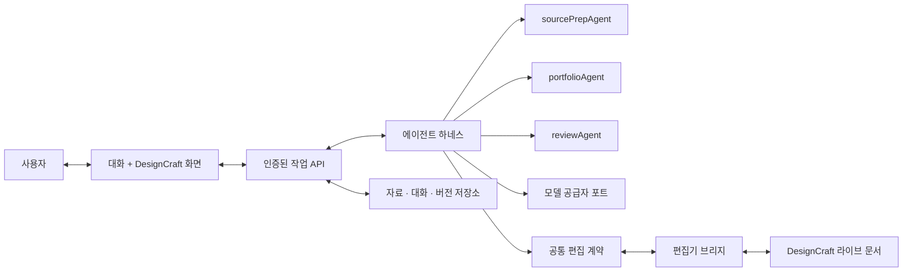

# 에이전트 하네스와 DesignCraft의 역할

상태: **설계 제안, 미구현**. 기준: [아키텍처](ARCHITECTURE-SPINE.md), [상세 설계](SOLUTION-DESIGN.md). 2026-11-09 대화에서 사용자가 제시한 제품 방향을 정리한다.

## 제품 흐름

1. 사용자가 자료와 의도를 채팅으로 전달한다.
2. 하네스가 자료 준비·기획·생성·검증 역할을 필요한 순서로 호출한다. 원본 자료와 사용자 요청을 구분하고 각 작업 상태를 사용자에게 보여 준다.
3. 포트폴리오 생성 결과를 DesignCraft의 **편집 가능한 문서**로 만든다. 백엔드의 파일 생성과 실제 WASM 편집기 열기 결과를 각각 확인한다.
4. 사용자가 화면을 보며 직접 편집하거나 “이 사진을 키워 줘”라고 요청한다.
5. 하네스가 현재 문서와 선택된 대상을 읽고 수정 제안을 만든다. 사용자가 승인하면 검증된 편집 명령을 적용하고, 변경 후 상태와 렌더를 확인한다.
6. 사용자가 원하는 결과를 저장하고, 실제 출력과 원본·권리·검토 상태를 확인한다.

핵심은 **생성 결과가 오른쪽에 나타나는 것과, 열린 문서를 다시 수정하는 것 모두**다. 첫 생성만 되고 이후 대화가 문서 상태와 분리되면 사용자의 반복 작업을 충족하지 못한다.

## 책임의 경계

| 구성 | 담당 |
|---|---|
| 하네스 | 대화·작업 상태, 역할 선택, 도구 호출 순서, 실패 처리, 사용자 승인, 결과 및 증거 기록. 대형 모델이 하네스 그 자체는 아니다. |
| 공통 편집 계약 | 문서/선택/페이지 읽기, 가능한 기능, 수정 제안, 승인·적용·오류·결과를 모델과 전송 방식에 독립적으로 정의. |
| API와 브리지 | API는 사용자·프로젝트를 검증하고 작업을 요청·조회한다. 브리지는 브라우저의 살아 있는 DesignCraft와 메시지를 교환한다. 각각 권한과 신뢰 경계를 별도로 검증한다. |
| DesignCraft | 열려 있는 편집 가능한 문서의 상태와 실제 객체 변경·렌더를 소유한다. 서버는 저장된 불변 문서 버전과 이력의 권위를 가진다. |
| 에이전트 모듈 | sourcePrepAgent는 자료 준비, portfolioAgent는 서사·페이지 생성과 편집 제안, reviewAgent는 독립 검토를 담당한다. 하네스는 이 책임을 합치지 않는다. |
| 모델 포트 | Claude, GPT/Codex 등 공급자별 호출, 실제 지원 기능·비용·오류를 격리한다. 미구현 공급자는 사용 가능하다고 표시하지 않는다. |

다이어그램의 연결은 **목표**다. 특히 서버 측 하네스가 브라우저의 라이브 편집기에 직접 접근하는 통로는 아직 없다. 실제 구현은 브라우저 세션의 연결·인증·재연결·취소를 명시해야 한다.

## API, 프로토콜, MCP

- **API**는 웹과 서버가 요청을 주고받는 접점이다. 프로젝트·작업·대화 HTTP API가 해당한다.
- **공통 프로토콜**은 문서 식별자, revision, 도구 이름, 입출력·오류·승인 의미를 정한다. HTTP, 브라우저 메시지, 나중의 MCP는 같은 계약을 운반하는 경계다.
- **하네스**는 모델이 도구를 어떤 순서로 쓰고 관찰·검증·재시도할지 관리한다.
- **MCP 어댑터는 선택적 상호운용 계층**이다. Claude Code나 Codex 같은 외부 호스트에서 동일 도구를 발견·호출해야 할 때 공통 계약 위에 얹는다. MCP 도입 자체가 편집 기능, 인증, 사용자 승인, 충돌 방지 또는 에이전트 품질을 자동으로 제공하지 않는다. 표준의 역할: [MCP architecture](https://modelcontextprotocol.io/specification/2025-11-25/architecture), [MCP tools](https://modelcontextprotocol.io/specification/2025-11-25/server/tools).
- 기존 ADR-0004의 HarnessRouter/UHP는 검증 전 선택 사항이다. 하네스가 필요하다는 것과 별도 HarnessRouter 서비스가 필수라는 것은 다르다.

## 최소 도구 계약 — 제안

| 도구 | 입력 / 출력 | 실행 조건 |
|---|---|---|
| `sources.list` / `sources.inspect` | 프로젝트·자료 버전 → 허용된 자료와 출처 | 사용자 권한·동의와 크기 제한 |
| `portfolio.plan` / `portfolio.compose` | 자료 버전·목적·규격 → 계획·편집 가능한 후보 | 불변 입력과 작업 ID; 완료 시 실제 파일 존재 확인 |
| `editor.capabilities` | 편집기 세션 → 실제 지원 연산·제한·프로토콜 버전 | 실행 중인 편집기가 응답한 기능만 반환 |
| `editor.inspect` / `editor.preview` | 세션·페이지/선택 범위 → 구조 또는 렌더와 revision | 라이브 문서 소유자, 전송 범위와 사용자 동의 확인 |
| `editor.propose` | 요청·관찰 상태 → 구조화된 수정안 | 객체·출처·허용 연산 검증; 이 단계에서 쓰지 않음 |
| `editor.apply` | 승인된 제안·예상 revision·요청 ID → 새 revision·변경 결과 | 편집기 내부 원자적 비교/적용과 권한·멱등성 검사 |
| `editor.save` / `export` | 검증된 문서 상태 → 버전·결과물·해시 | 기존 원본과 시도를 덮어쓰지 않음 |
| `review.run` | 특정 문서 버전과 실제 렌더 → blocking/advisory 및 리뷰 | 작성과 독립된 리뷰; 수정 시 기존 리뷰 무효화 |

각 호출은 `protocol_version`, `request_id`, `project_id`, `document_id` 또는 작업 범위, `session_id`, 작업명과 검증 가능한 입력을 가진다. 응답은 `request_id`, 실제 사용된 capability, `ok / rejected / conflict / unsupported / failed / unknown_outcome`, 결과와 경고를 구분한다. 특정 필드는 각 도구에 적합할 때만 사용한다. 버전이나 기능이 맞지 않으면 협상하거나 명시적으로 실패한다.

## 현재 구현

- 기존 생성 파이프라인은 `book.designcraft`를 생성하고 별도 편집기 화면으로 전달할 수 있다. 이것은 채팅 하네스가 자율적으로 전체 포트폴리오를 만들었다는 증거가 아니다.
- 웹 편집기 브리지는 제한된 객체 생성·텍스트 입력·undo/redo와 `document.inspect`만 허용한다. 채팅은 저장된 PDF 텍스트와 사용자가 선택한 라이브 구조를 사용할 수 있다.
- 채팅은 Claude CLI에 의존하며 시각 이미지 이해, 자율적 포트폴리오 생성/수정, 실시간 결과 피드백, 공통 하네스, MCP 서버, 원자적 revision·승인 및 다중 사용자 권한은 미구현이다.
- 사용자가 필요한 기존 클라우드 프로젝트는 그대로 둔다. Supabase/Cloudflare 공급자 및 서비스 운영 방식은 별도 결정이다.

## 구현 순서

1. **대화 → 첫 결과 열기:** 기존 sourcePrep·portfolio 생성 API를 하네스 작업으로 연결해 실제 `.designcraft` 결과를 열고 실패·진행 상태를 표시한다. 합성 모델은 합성으로 표시한다.
2. **관찰 → 제안:** 현재 문서·선택 객체의 안정 ID, live revision, 실제 렌더 미리보기와 capability를 검증해 하네스에 제공한다. 시각 모델에 보내는 자료와 범위에 사용자 동의를 받는다.
3. **승인된 단일 수정:** 실제 객체 하나를 변경하는 도구부터, 예상 revision 확인과 적용을 편집기 단일 쓰기 경계에서 원자적으로 수행한다. 충돌·중복 요청·중단·undo·범위 밖 영향·미지원 기능을 테스트한다.
4. **반복 및 검토:** 변경 후 재조회·렌더 → 오류/출처 검증 → 필요 시 추가 제안. 정해진 반복 한도, 취소, 사람 승인 및 독립 리뷰를 유지한다.
5. **다른 호스트 연결:** 실제 계약과 권한이 검증된 뒤 필요에 따라 동일 도구를 MCP로 노출하고 Claude/Codex 호스트 양쪽에서 상호 운용을 검증한다. 별도 서비스는 운영상 필요가 입증될 때만 추가한다.

디자인 품질은 파이프라인 성공이 아니라 권리 확인된 실제 사례와 사람 블라인드 비교로 별도 검증한다.
