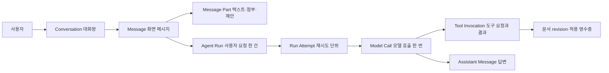

# LLM 대화와 에이전트 실행 데이터 설계

상태: **설계 초안 · SQL 미작성 · 미적용**. 2026-11-10. [전체 데이터 설계](README.md)의 대화·실행 부분을 구체화하며, 충돌 시 이 문서가 해당 부분의 최신 설계다. 현재 대화는 React 메모리에 있고, 최근 메시지 최대 20개와 선택한 편집기 구조를 Claude CLI에 전달한다. 아래 모델 호출 이력·도구 이력·영속화는 아직 구현되지 않았다.

## 한 대화에서 구분할 것

대화방은 프로젝트에 속하고, 메시지는 대화방에 속한다. 하나의 사용자 요청은 한 run을 만들며 run에는 재시도 attempt가 여러 개 있을 수 있다. 하나의 attempt가 여러 모델 호출·도구 호출을 할 수도 있다. 현재 Claude CLI가 제공하지 않는 호출 ID·모델명·토큰 수는 **null/unknown**으로 남긴다. 공급자 내부의 사고 과정이나 API 키를 저장하려고 설계하지 않는다.

## 테이블 계약

각 테이블의 PK는 `uuid`, 시간은 `timestamptz`, 서버가 생성한다. 이하 `project_id`와 부모 ID의 조합은 해당 부모의 같은 프로젝트를 가리키도록 복합 FK로 묶고, 그 FK 대상에 정확히 대응하는 `UNIQUE`를 둔다. `conversation_id`와 메시지·run도 **같은 대화방**이어야 하므로 필요한 경우 `(project_id,conversation_id,id)` 복합 FK까지 둔다. nullable FK를 가진 다형 참조에는 `CHECK`로 허용되는 조합을 명시한다. 삭제·보존 정책 확정 전 연쇄 삭제는 기본값으로 넣지 않는다.

| 테이블 | 필수 컬럼과 관계 | 제약·역할 |
|---|---|---|
| `conversations` | `id`, `project_id`, `created_by`, `title`, `next_message_seq`, `created_at`, `updated_at`, `archived_at?` | 프로젝트·소유자 확인. `next_message_seq`는 서버 트랜잭션에서 행 잠금 후 할당. `unique(project_id,id)`. 대화 목록은 `(project_id, updated_at desc, id)` 커서. |
| `messages` | `id`, `project_id`, `conversation_id`, `sequence`, `author_kind`(user/assistant/system/tool), `state`, `created_at`, `client_request_id?`, `reply_to_message_id?`, `run_attempt_id?` | `unique(conversation_id,sequence)`, `unique(project_id,conversation_id,id)`. 클라이언트 요청 ID는 사용자 메시지에서 필수, `(conversation_id,client_request_id)` 유일. 답변·재생성은 원본을 덮어쓰지 않고 서로 다른 메시지와 attempt로 구별. `reply_to`도 같은 대화방. 클라이언트는 user 메시지만 만들 수 있다. |
| `message_parts` | `id`, `project_id`, `conversation_id`, `message_id`, `ordinal`, `kind`, `text_content?`, `asset_version_id?`, `proposal_id?`, `schema_version` | 메시지 안에 텍스트·첨부·제안의 순서를 보존. `(message_id,ordinal)` 유일. `kind`마다 허용 필드와 NULL 조합을 CHECK/서버 검증. 첨부는 동일 프로젝트의 ready 자산 버전만 허용. 사용자 메시지와 에이전트가 실제 전송받은 범위는 별도. |
| `agent_runs` | `id`, `project_id`, `conversation_id`, `request_message_id`, `agent_kind`, `status`, `idempotency_key`, `created_at`, `finished_at?` | 요청 메시지와 같은 대화여야 한다. `(project_id,idempotency_key)` 유일. run은 사용자 요청의 논리 단위이며 재생성/새 요청과 중복 전송을 구분한다. 요청을 DB에 저장하기 전에 공급자를 호출하지 않는다. |
| `run_attempts` | `id`, `project_id`, `conversation_id`, `run_id`, `attempt_no`, `status`, `lease_owner?`, `lease_expires_at?`, `started_at?`, `finished_at?`, `failure_code?` | `(run_id,attempt_no)` 유일. 진행·실패·취소·결과불명 이력 보존. lease와 상태 변경은 원자적 compare-and-set; 잠금이 만료돼도 외부 도구가 실행됐을 수 있으므로 무조건 재실행하지 않는다. durable queue 자체는 별도 구현. |
| `model_calls` | `id`, `project_id`, `conversation_id`, `run_attempt_id`, `ordinal`, `provider`, `requested_model?`, `actual_model?`, `provider_request_id?`, `status`, `started_at`, `finished_at?`, `input_tokens?`, `output_tokens?`, `cost_amount?`, `currency?`, `usage_source?`, `error_code?` | `(run_attempt_id,ordinal)` 유일. 요청/실제 모델 구분. 확인되지 않은 usage·가격은 null, 추정값은 출처를 별도 기록. 하나의 응답에 여러 호출이 있을 수 있다. 모델·호출 ID가 확인되지 않으면 만들어내지 않는다. |
| `model_call_inputs` | `project_id`, `conversation_id`, `model_call_id`, `ordinal`, `kind`, `message_id?`, `asset_version_id?`, `document_version_id?`, `snapshot_id?`, `scope`, `sha256?` | 정확히 하나의 참조만 허용, 순서 유일. 모델에 실제 전달한 대화·자료·문서 범위를 기록한다. 일부만 추출/잘랐다면 범위·길이·잘림 상태를 기록. 해시만으로 원문을 복원할 수 있다고 주장하지 않는다. |
| `context_snapshots` | `id`, `project_id`, `conversation_id`, `kind`, `document_version_id?`, `editor_session_id?`, `editor_revision?`, `payload_ref?`, `payload_sha256`, `created_at`, `retention_until?` | 저장된 문서 버전과 unsaved 편집기 상태는 구분한다. 라이브 상태는 사용자 동의를 받은 제한된 필드만 저장하며 경로·키를 제외. 안전한 revision을 얻지 못하면 null과 불확실 상태로 남긴다. 큰 본문은 비공개 객체 참조; 보존기간·암호화 정책은 미확정. |
| `tool_invocations` | `id`, `project_id`, `conversation_id`, `run_attempt_id`, `model_call_id?`, `ordinal`, `tool_name`, `provider_call_id?`, `request_id`, `status`, `arguments_ref?`, `result_ref?`, `started_at`, `finished_at?` | `(run_attempt_id,request_id)` 유일. 공급자의 tool-use ID와 우리 멱등 요청 ID는 다르다. 병렬 호출은 각각 기록하고 결과를 해당 호출에 묶는다. 상태 requested/awaiting_approval/running/succeeded/rejected/failed/unknown_outcome. 미지원 도구는 실행하지 않는다. |
| `edit_proposals` | `id`, `project_id`, `conversation_id`, `run_attempt_id`, `document_id`, `base_document_version_id?`, `editor_session_id?`, `expected_revision?`, `status`, `created_at` | 실제 실행 전 제안과 사람이 승인한 범위를 구분. revision을 검증할 수 없다면 안전한 자동 적용을 허용하지 않는다. 현재 코드에는 이 전체 모델이 없다. |
| `edit_receipts` | `id`, `project_id`, `proposal_id`, `tool_invocation_id`, `request_id`, `status`, `before_revision?`, `after_revision?`, `result_document_version_id?`, `created_at` | 중복 적용 방지, 충돌 및 결과불명 별도 표시. `request_id` 유일; 저장된 버전과 라이브 revision을 혼동하지 않는다. 편집기 원자적 비교/적용이 실제 구현되어야 유효하다. |

메시지 상태는 `pending`, `streaming`, `completed`, `failed`, `cancelled`, `unknown_outcome`으로 제한한다. 화면에는 상태와 실패 이유를 구분해 표시한다. 사용자 메시지는 수락 후 `completed`이며, 생성 도중의 assistant 메시지는 `streaming`에서 종료 상태로 전이한다. 스트리밍 조각을 모두 DB 이벤트로 저장할지, 일정 간격으로 합칠지는 미결정이다. 전송 실패한 입력을 사용자가 복구할 수 있어야 하며, 클라이언트의 임시 표시를 서버 저장 완료로 간주하지 않는다.

기존 전체 설계의 `messages.role/content`는 이 문서의 `author_kind`와 `message_parts` 계약으로 대체한다. 기존 `message_attachments`는 메시지 part의 자산 참조로 통합하고 `model_call_inputs`는 실제 전송 기록으로 분리한다. 기존 `agent_runs`의 단일 `provider/model`은 요약 캐시가 아닌 한 제거하고, 실제 호출 정보는 `model_calls`에 둔다. 이 결정은 아직 코드나 SQL에 적용되지 않았다.

## 예시: 이미지와 수정 요청

1. 사용자가 프로젝트 P에서 대화 C에 메시지 M을 보내고 이미지 버전 A를 첨부한다. DB가 P/C/M/A의 관계와 A의 ready 상태를 검증한다.
2. 서버는 동일 트랜잭션에 M·part·run을 저장하고 커밋한다. 같은 `client_request_id`의 재전송은 기존 요청을 돌려준다. 별도의 큐/worker가 run을 claim한다.
3. 사용자가 라이브 편집 상태 전송에 동의한 경우에만 현재 상태를 제한적으로 읽고 snapshot을 기록한다. 어떤 이미지·문서·텍스트가 실제로 모델에 갔는지 `model_call_inputs`에 기록한다.
4. 모델이 편집을 제안하면 proposal과 필요 시 tool invocation을 기록한다. 사용자 승인이 필요한 작업은 승인 이전에 변경하지 않는다. 예상 revision 검증 실패는 conflict로 종료한다.
5. 실행 후 receipt와 새 document version·native/PDF 산출물 해시를 기록하고 화면 메시지를 저장한다. 공급자나 편집기 연결이 끊겨 결과를 모르면 `unknown_outcome`으로 남겨 중복 실행하지 않는다.

## 보안과 삭제

- 모든 읽기는 프로젝트 소유권과 대화 소속을 확인한다. `authenticated` 자체는 소유권이 아니다. 일반 사용자에게 assistant/system/tool 메시지, model_calls, run 결과, receipt·검토 결과 위조 권한을 주지 않는다. 서버 역할 키는 RLS 우회 가능하므로 서버 권한 검사가 필수다.
- 공급자 토큰·API 키·쿠키·Authorization 헤더, 미확인 전체 프롬프트 및 내부 사고 과정은 저장 금지. 사용자 자료와 도구 출력은 비신뢰 입력이며 모델이 지시한 대로 권한을 확대하지 않는다. 도구 인자/결과와 오류 로그는 크기 제한·민감값 제거·비공개 접근을 적용한다.
- 대화 삭제, 사용자 요청에 의한 기록 삭제, 프로젝트 삭제와 객체 삭제는 연관 메시지·snapshot·공급자 보존 정책을 함께 다룬다. 실제 보존기간·감사 의무는 미결정이며 자동 영구 보존이나 삭제를 전제하지 않는다. 백업·서드파티 전송본은 별도 정책과 확인이 필요하다.
- 대화는 DB가 권위 있는 기록이고, 공급자의 대화 ID가 있더라도 선택적인 참조로 취급한다. 장애 복구 시 공급자 상태와 우리 기록이 어긋날 수 있으므로 이를 명시한다.

## 필수 검증

1. 두 계정·다른 프로젝트·같은 프로젝트의 다른 대화를 대상으로 모든 SELECT/INSERT/UPDATE/DELETE와 FK 교차 연결, 시스템/assistant/tool 결과 위조를 거부한다. RLS뿐 아니라 GRANT, 서버 전용 API, Storage 정책을 함께 검사한다.
2. 동시에 보낸 두 메시지의 sequence 유일성, 동일 요청 재전송, 답변 재생성, 취소·장애·lease 만료, 부분 스트리밍 후 재연결, 모델 호출 중 네트워크 단절, 중복 도구 실행을 시험한다.
3. 전송하지 않은 이미지가 입력 이력에 찍히지 않는지, 저장 버전과 미저장 편집기 상태가 구분되는지, 오래된 revision·다른 프로젝트 ID가 거부되는지 검사한다.
4. GitHub/이메일 로그인 → 대화 저장 → 새로고침/재로그인 → 이어 대화 → 에이전트 결과 및 편집기 저장까지 실제 브라우저·API·DB·객체 저장소에서 확인한다. 실제 모델 호출과 테스트 더블을 구별한다.

## 자료 및 설계 판단

- [Vercel AI Chatbot의 Chat/Message 스키마](https://github.com/vercel/chatbot/blob/main/lib/db/schema.ts)는 메시지의 `parts`와 첨부를 구분하는 예다. 이 프로젝트는 관계 무결성과 권한 검사를 위해 part/참조를 별도 행으로 설계했다. 예제 코드를 가져와 실행한 것은 아니다.
- [Claude 도구 호출](https://platform.claude.com/docs/en/agents-and-tools/tool-use/handle-tool-calls)은 모델의 도구 요청 ID와 도구 결과를 연결한다. 우리 내부 멱등 ID 및 승인 이력은 별도 책임이다.
- [Supabase RLS](https://supabase.com/docs/guides/database/postgres/row-level-security)는 정책과 별개로 실제 GRANT를 점검해야 한다. `anon`/`authenticated`의 기존 권한을 자동으로 안전하다고 가정하지 않는다.
- 멀티모달 UI 메시지의 일반적 part 구조는 [AI SDK UIMessage](https://ai-sdk.dev/docs/reference/ai-sdk-core/ui-message)를 참고했다. 특정 SDK나 공급자에 이 DB 계약을 종속시키지 않는다.

이 문서는 설계이며 실제 DB 생성, RLS 정책, 마이그레이션, API나 에이전트 하네스가 구현되었음을 의미하지 않는다.
