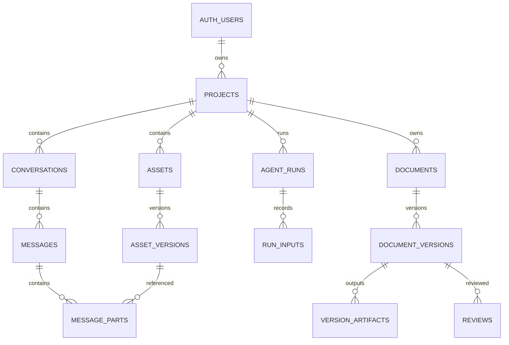

# Portfolio Agent 데이터베이스 설계

상태: **설계 초안 · SQL 미적용**. 기준일: 2026-11-10. 프로젝트·대화 영속화부터 에이전트와 DesignCraft 편집 이력까지 공통으로 사용하는 데이터 계약이다. [기존 웹 데이터 설계](../WEB_DATA_DESIGN.md)와 [에이전트 하네스](../agent-editor/PROTOCOL-HARNESS.md)를 구체화한다. 현재 구현과 목표 구조는 다르다.

대화·LLM 호출·도구 실행에 대한 최신 상세 계약은 [LLM_CONVERSATION_DESIGN.md](LLM_CONVERSATION_DESIGN.md)를 따른다. 아래 표의 대화 관련 필드는 개요이며 상세 계약에서 `message_parts`, `run_attempts`, `model_calls`, `tool_invocations` 등으로 보완한다.

## 현재 사실과 결정

- 현재 Supabase Auth 이메일/GitHub 로그인은 실제 검증됐지만, 앱 데이터는 사용자별 서버 로컬 파일이다. 대화는 브라우저 메모리에 있고, 클라우드 저장은 구현되지 않았다.
- 사용자 식별자는 Supabase `auth.users.id` UUID를 참조한다. 비밀번호·OAuth 토큰·LLM API 키는 앱 테이블에 저장하지 않는다.
- 1차 데이터는 **개인 소유 프로젝트**다. 협업 멤버십, 조직 및 결제는 별도 설계로 미룬다. 향후 공유 기능이 생기면 프로젝트 권한 모델을 별도로 바꾸며, 현재의 소유자 정책을 그대로 공유 정책으로 취급하지 않는다.
- PostgreSQL은 구조화된 관계와 상태를 소유한다. 이미지·원본·DesignCraft·PDF의 바이트는 비공개 객체 저장소에 둔다. 1차 후보는 Supabase Storage; Cloudflare R2는 동일한 객체 참조 계약의 대안이며 확정된 통합은 없다.
- 원본·문서 버전·검토의 증거를 덮어쓰지 않는다. 저장 작업 성공과 사람이 내용·출처를 확인했다는 것은 별도 상태다.



## 1차 테이블 계약

공통: `id uuid`는 서버 기본값으로 생성, `created_at timestamptz`는 DB에서 생성한다. `project_id`가 있는 자식은 **복합 외래키**로 참조 대상의 `project_id`와 자신의 `project_id`가 일치해야 한다. 모든 인덱스는 예상 쿼리용 초안이며 실제 `EXPLAIN` 확인 전 성능 보장은 없다.

| 모듈/테이블 | 주요 컬럼과 관계 | 제약과 인덱스 |
|---|---|---|
| `projects` | `id`, `owner_id → auth.users`, `slug`, `title`, `brief`, `created_at`, `updated_at`, `deleted_at` | `(owner_id, slug)` 유일. 소유권 변경은 일반 사용자에게 금지. `(owner_id, updated_at desc, id)` 목록 인덱스. 로컬 slug와 전역 UUID를 구분한다. |
| `conversations` | `id`, `project_id`, `title`, `created_by → auth.users`, `created_at`, `updated_at`, `archived_at` | `unique(project_id,id)`를 제공해 자식의 복합 FK 대상이 된다. `(project_id,updated_at desc,id)` 인덱스. |
| `messages` / `message_parts` | 메시지 ID·대화 ID·순서·작성자·상태와 각 part의 텍스트·첨부·제안 | 메시지 내 순서를 보존하고 사용자가 assistant 메시지를 위조하지 못하게 한다. 상세 제약은 대화 설계 참조. |
| `assets` | `id`, `project_id`, `kind`, `display_name`, `created_at`, `deleted_at` | 자료의 논리 ID. `unique(project_id,id)`; `(project_id,created_at desc,id)` 인덱스. 원본을 덮어쓰지 않는다. |
| `asset_versions` | `id`, `project_id`, `asset_id`, `version_no`, `state`, `storage_provider`, `bucket`, `object_key`, `sha256`, `byte_size`, `mime_type`, `parent_version_id`, `created_at` | `unique(asset_id,version_no)`, `unique(storage_provider,bucket,object_key)`, `unique(project_id,id)`. parent는 같은 asset/project의 이전 버전이어야 한다. state는 pending/ready/failed; ready는 해시·크기 필수. 실제 객체의 해시 검증은 서버 책임. |
| `agent_runs` / `run_attempts` / `model_calls` | 논리 요청, 재시도, 실제 모델 호출을 별도 기록 | 요청 중복 방지와 결과 불명 상태를 구분. 실제 모델·비용 미확인은 null. 대화 없이 시작되는 생성 작업과 그 입력 계약은 별도 정의가 필요하다. |
| `model_call_inputs` / `context_snapshots` / `tool_invocations` | 실제 전달된 자료·편집 상태와 도구 호출·결과 | 동일 프로젝트 및 대화 범위를 검증. 전송한 범위와 미전송 자료를 구별. 상세 계약 참조. |
| `documents` | `id`, `project_id`, `title`, `created_at` | `unique(project_id,id)`; 논리 문서와 버전을 분리. |
| `document_versions` | `id`, `project_id`, `document_id`, `version_no`, `parent_version_id?`, `source_run_id?`, `state`, `created_at` | 문서 내 버전 유일, parent는 같은 문서·프로젝트. 비교용 parent만으로 파일 파생이 증명된다고 표현하지 않는다. ready 조건은 필수 산출물의 실제 확인 결과로 판단. |
| `version_artifacts` | `id`, `project_id`, `document_version_id`, `kind`(native/pdf/preview/manifest), `storage_provider`, `bucket`, `object_key`, `sha256`, `byte_size`, `mime_type`, `page_no?` | 단일 버전·종류·페이지 조합 유일. native와 PDF는 개별 바이트·해시를 보존. 객체 키 전역 유일. 미확인 파일을 ready로 확정하지 않는다. |
| `reviews` | `id`, `project_id`, `document_version_id`, `reviewer_id`, `review_context_hash`, `scores`, `blockers`, `attestations`, `created_at` | 해시·검토자·버전에 귀속. 사람이 확인한 사실만 기록. 버전이나 출처 변경 시 이전 결과를 새 파일의 합격으로 재사용 금지. `scores` JSON 형태·범위는 계약과 DB 검사로 제한. |

복합 FK의 참조 대상에는 해당 열 순서의 `UNIQUE` 제약을 모두 둔다. 특히 `messages`, `agent_runs`, `document_versions`에도 `unique(project_id,id)`가 필요하고, 같은 asset/document 부모 버전을 강제하려면 각각 `(project_id, asset_id, id)`, `(project_id, document_id, id)` 유일 제약이 추가로 필요하다. 산출물 `page_no`가 NULL인 경우 일반 `UNIQUE`만으로 중복을 막을 수 없으므로 `NULLS NOT DISTINCT` 또는 NULL/비NULL 분리 부분 유일 인덱스를 사용한다. self-parent, 순환과 미래 버전 참조는 같은 행 CHECK만으로 막을 수 없으며 직렬화된 서버 명령에서 검증한다.

`asset_derivations`, 상세 편집 명령/receipt, 협업 권한, 결제, 토큰 사용량은 2차 확장이다. 원본→파생의 실제 다중 입력이 필요해지면 `asset_derivations`/입력 연결 테이블을 도입한다. 모델 변경이나 기능 추가를 위해 테이블을 임의로 하나의 JSON 덩어리로 합치지 않는다.

## 쓰기·동시성·복구

1. 메시지 저장과 순서 배정은 서버 트랜잭션에서 대화 행을 잠가 `sequence`를 증가시킨다. 클라이언트가 `max(sequence)+1`을 계산하지 않는다. 요청 ID로 재시도 중복을 막는다. 답변 실패도 상태로 남긴다.
2. 업로드는 서버가 사용자·프로젝트·형식·크기를 확인한 뒤 고유한 임시 객체를 발급한다. 서버가 실제 바이트·해시·형식을 확인하고 `asset_versions`를 ready로 만든다. 객체와 DB는 하나의 트랜잭션이 아니므로 누락·중복·중단을 재시도 가능한 상태로 기록하고 고아 객체를 정리한다.
3. 문서 저장은 불변 객체 업로드 → 해시/렌더 확인 → 단일 DB 트랜잭션으로 버전과 산출물 확정 순서. 실패한 업로드와 도중 성공 여부가 불명인 실행은 성공으로 바꾸지 않는다.
4. 작업 큐의 claim/lease, 재시도·중복 방지, 프로세스 장애 복구는 별도 설계다. `agent_runs` 행만으로 내구성 있는 큐가 구현된 것은 아니다.
5. 삭제는 프로젝트 접근을 즉시 차단하는 soft-delete → 백그라운드 객체·파생물 제거 → 참조 및 백업 보존 정책에 맞춘 정리. 객체 삭제 실패는 재시도 상태로 남긴다. 복구 기간·백업 보존기간과 사용자에게 표시할 문구는 미결정이다.

## 권한 계약

- 각 공개 테이블에 RLS를 켜고 `anon` 직접 접근을 막는다. 프로젝트의 소유자만 읽기/쓰기가 가능하며 자식은 신뢰 가능한 `project_id → projects.owner_id = auth.uid()`를 기준으로 검사한다. 단순히 `authenticated` 역할만 검사하지 않는다.
- INSERT는 `WITH CHECK`, UPDATE는 기존 행 `USING`과 새 행 `WITH CHECK`를 모두 적용한다. 일반 클라이언트가 소유자, 타 프로젝트 참조, 시스템 역할 메시지, 에이전트 실행 결과, 파일 해시·검증 상태, 다른 사용자 검토를 위조하지 못하게 **컬럼 권한과 서버 전용 쓰기 경계**를 추가한다. RLS만으로 무결성이 완성되지는 않는다.
- 서버가 사용자 JWT로 DB에 접근하면 RLS가 적용된다. 서비스 역할 키는 RLS를 우회하므로 클라이언트에 두지 않고, 서버에서 쓸 경우 모든 작업에 독립적인 소유권 검증이 필요하다.
- Storage는 비공개 버킷을 기본으로 한다. 객체 키는 `users/{owner_uuid}/projects/{project_uuid}/{kind}/{random_object_id}` 같은 충돌 불가능한 경로를 사용하고, DB 권한과 실제 Storage 정책이 일치해야 한다. 사용자 UUID 폴더만 검사하는 정책으로 프로젝트·삭제 상태를 증명했다고 간주하지 않는다. 임시 서명 URL은 짧은 만료, 발급 전 권한 확인, 삭제 후 잔여 유효 기간을 다룬다.
- RLS 정책과 FK를 적용한 SQL은 별도 마이그레이션으로 작성해 깨끗한 DB에서 실행·검증하기 전에는 운영 DB에 적용하지 않는다. 이 문서는 실행 가능한 마이그레이션이 아니다.

## 모듈과 이행 순서

```text
backend/apps/api/src/pascal_api/
  projects/       프로젝트와 권한 경계
  conversations/ 대화·메시지·첨부·페이지네이션
  assets/         업로드 확정·불변 버전·출처
  runs/           에이전트 실행 이력과 입력 근거
  documents/      문서·불변 버전·산출물
  reviews/        해시로 묶인 사람 검토
  storage/        DB 및 객체 저장소 포트/어댑터
supabase/
  migrations/     순서 있는 SQL (별도 구현 후 생성)
  tests/          RLS 및 관계 무결성 통합 검증
```

1. Auth/RLS + projects → 실제 사용자 두 명 격리 검증.
2. conversations/messages 저장 및 기존 채팅 패널 연결 → 새로고침·순서·중복 요청 검증.
3. assets/asset_versions와 비공개 객체 저장 → 업로드 중단·복구·해시·교차 사용자 검증.
4. runs 및 document versions → 실제 생성·DesignCraft 저장·PDF와 검토 증거 연결.
5. 기존 로컬 데이터는 소유자 명시·백업·검증·재시도 가능한 **별도 이전 도구**로만 가져온다. 현재 로컬 데이터를 자동 삭제·이전하지 않는다.

## 검증 게이트

- A/B 사용자, 익명 및 잘못된 JWT로 모든 테이블과 객체에 대해 select/insert/update/delete와 직접 파일 URL을 검사한다. 다른 프로젝트를 가리키는 첨부·문서·run FK, owner 변경, 위조 assistant/review 기록을 거부해야 한다.
- 중복 전송, 두 탭 동시 메시지·문서 버전 생성, 업로드 중단, 객체 없는 ready, 해시 불일치, DB/Storage 장애, 삭제 중 요청·고아 정리, 만료 링크·재시도를 검사한다.
- 실제 브라우저 → 인증된 API → DB/객체 → 에이전트 → DesignCraft → 저장 → 검토까지 확인한다. 서비스 키 우회 경로 및 로컬 무인증 모드가 외부로 노출되지 않는지도 별도 확인한다.

## 조사한 재사용 자료

- [Supabase 공식 사용자 관리 SQL 예제](https://github.com/supabase/supabase/blob/master/examples/user-management/expo-user-management/supabase/migrations/20240403090422_init.sql): Auth 사용자와 프로필·RLS·Storage 정책 패턴 참고. 본 프로젝트 테이블에 그대로 복사한 것은 아니다.
- [Supabase RLS 가이드](https://supabase.com/docs/guides/database/postgres/row-level-security): 소유자 정책, `WITH CHECK`, 정책 열 인덱스 참고.
- [Supabase Storage 접근 제어](https://supabase.com/docs/guides/storage/security/access-control): 비공개 객체와 RLS 패턴 참고.
- [Supabase RLS 테스트](https://supabase.com/docs/guides/database/postgres/testing-row-level-security): 실제 DB 정책을 다중 사용자로 검증하는 방법 참고.

이 초안은 공식 예제를 기반으로 한 독립 설계이며 실제 SQL 실행·RLS·마이그레이션·부하·클라우드 연결은 아직 검증하지 않았다.
